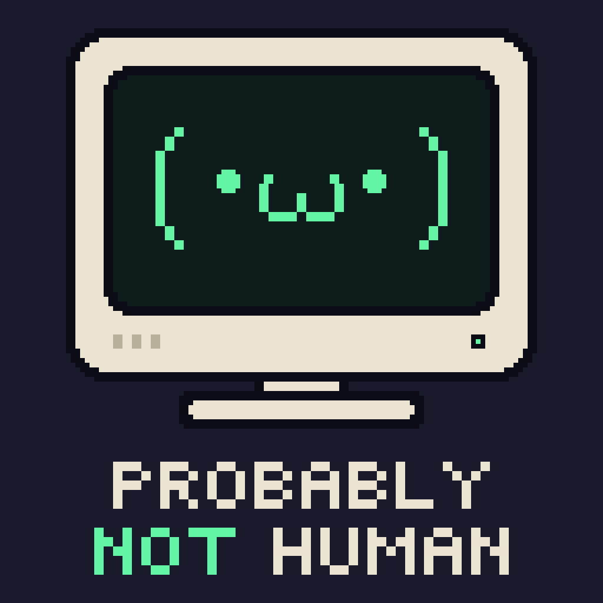

<div align="center">



# Probably Not Human

Let an AI agent run your shop in [Probably Stolen](https://store.steampowered.com/app/4348910/).

**English** | [简体中文](README.zh-CN.md)

</div>

Probably Not Human is a mod for Probably Stolen that comes with an MCP server. It exposes the game state and every player action to AI agents like Claude Code, Codex or Cursor, so they can play the game on their own: call customers, appraise, haggle, buy and sell, scavenge at night, pay the rent.

> [!WARNING]
> The agent plays on your real save. It spends money, sells your stock and saves the game. Use a spare save slot.

## Features

- 74 actions covering the whole game: day cycle, customers and dialogue, trading and bargaining, items and tools, night trips, phone, saves
- Full game state as JSON: items and their real values, inventories, customers and budgets, bargain odds, calendar, news, documents
- Wait conditions (customer ready, dialogue finished, day 12, ...), so the agent doesn't have to sleep or poll
- Screenshots and virtual mouse/keyboard input for anything without a dedicated action
- Works with any MCP client, and can also be used from the command line or as a Python library
- Runs locally. The mod has no network access and needs no mod permissions
- The client is pure Python with no dependencies

## Requirements

- Probably Stolen on Windows (tested on build `100-Rev13`)
- Python 3.10+
- An MCP client such as Claude Code, Codex, Claude Desktop or Cursor, or any agent that can run shell commands

## Installation

1. Subscribe to [Probably Not Human](https://steamcommunity.com/sharedfiles/filedetails/?id=3842466338) on the Steam Workshop. In the game, open **Mods**, activate it and restart the game.

2. Install the client:

   ```sh
   pip install https://github.com/TundraWork/ProbablyNotHuman/archive/refs/heads/main.zip
   ```

3. Start the game and check that the client can reach it:

   ```sh
   probably-not-human health
   ```

4. Add the MCP server to your client. For Claude Code:

   ```sh
   claude mcp add probably-stolen -- probably-not-human mcp
   ```

   For other clients, the command is `probably-not-human` and the argument is `mcp`. See [docs/setup.md](docs/setup.md) for config examples, WSL and troubleshooting.

## Usage

Ask your agent to play. For example:

> Play Probably Stolen with the probably-stolen tools. Load save slot 3 and run the shop for one day, then tell me how it went. Don't touch the other save slots.

You can also script it in Python:

```python
from probably_not_human import Client

client = Client()
client.act("day.open")
client.wait({"phase": "OPEN"}, timeout=30)
client.act("customer.next")
print(client.observe(["trade"], compact=True))
```

## Notes

- The agent sees more than a player does. Real item values, customer budgets and bargain odds are all included.
- The mod contains no strategy and gives the agent no hints. How well it plays depends on the model.
- The client and the mod talk through files in the game's `ModData` folder. Other programs on your PC can read and write that folder too while the mod is active.
- A game update may break the mod until it is updated.

## Documentation

| | |
| --- | --- |
| [Setup](docs/setup.md) | Config for each MCP client, WSL, troubleshooting, uninstalling |
| [Client](docs/client.md) | Command line, Python library, wait conditions, MCP server |
| [Observations](docs/observations.md) | What the agent can see |
| [Actions](docs/actions.md) | All 74 actions and what they return |
| [Transport](docs/transport.md) | How the client and the mod talk to each other |
| [Development](docs/development.md) | Building the mod, running tests, publishing to the Workshop |

## License

[MIT](LICENSE)

This project is not affiliated with Questing Goose Studio and does not include any game code or assets.
